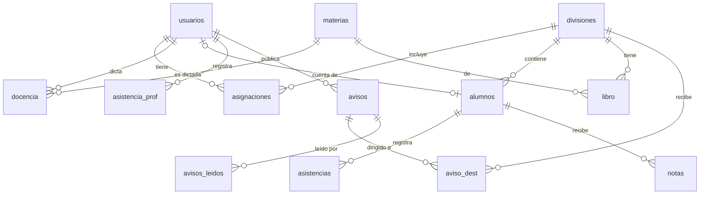
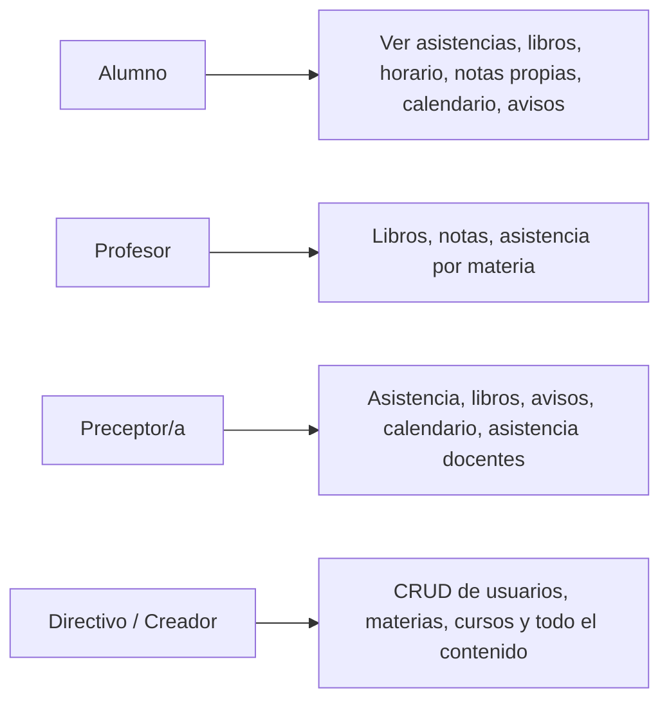

# Asistencias.Pro · C.E.N. Nonogasta

**Proyecto Final Integrador 2026 · 5° Año T.I.P.P.** · Tecnología de Gestión y Prácticas Profesionalizantes I · Docente: Prof. Guardia, Sebastián Nicolás

**Integrantes:** [Apellido y Nombre 1] · [Apellido y Nombre 2] · [Apellido y Nombre 3] — Div. [A/B/C]

Sistema web de asistencias con roles (creador, directivo, preceptor/a, profesor/a, alumno/a), organizado por años (1° a 6°) y divisiones (1ra y 2da): asistencia diaria y análisis mensual, libro de temas, libro de exámenes, notas, horario, calendario por año, avisos con notificación y asistencia de docentes.

## Stack (según la guía)
| Capa | Tecnología |
|---|---|
| Frontend | HTML5, CSS3, JavaScript ES6+ (Fetch API), Bootstrap 5 |
| Backend | Node.js + Express (API REST en `api/index.js`) |
| Base de datos | PostgreSQL en Supabase (`database.sql`) |
| Versiones / Deploy | Git + GitHub / Vercel |

## Estructura
```
public/  index.html (consulta/Read) · crear.html (Create) · editar.html (Update) · css/styles.css · js/main.js · js/api.js
api/     index.js (Express) · config.js (cliente Supabase)
database.sql · vercel.json · package.json · .env.example · .gitignore
```

## Puesta en marcha (local)
1. Crear un proyecto en **supabase.com** → **SQL Editor** → pegar todo `database.sql` → **Run**.
2. **Project Settings → API**: copiar *Project URL* y la clave **service_role**.
3. Copiar `.env.example` como `.env` y completar `SUPABASE_URL`, `SUPABASE_SERVICE_KEY` y `JWT_SECRET`.
4. Instalar [Node.js 18+](https://nodejs.org), abrir una terminal en la carpeta y ejecutar `npm install` y luego `npm start`.
5. Abrir **http://localhost:3000** en el navegador (la terminal solo inicia el servidor).

## Subir a GitHub y publicar en Vercel
```
git init
git add .
git commit -m "Entrega Backend y Frontend integrados"
git remote add origin https://github.com/USUARIO/NOMBRE-PROYECTO.git
git branch -M main
git push -u origin main
```
En **vercel.com** → *Add New Project* → importar el repositorio → **Environment Variables**: cargar `SUPABASE_URL`, `SUPABASE_SERVICE_KEY` y `JWT_SECRET` → **Deploy**. El link `https://…vercel.app` es el que se carga en PROJECTHUB.

## Cuentas de prueba
| Usuario | Contraseña | Rol |
|---|---|---|
| creador | creador123 | Todo |
| directivo | dir123 | Todo |
| preceptor5 / preceptor1 | prec123 | Preceptoras (5°-6° / 1°-4°) |
| profesor / profesor2 | prof123 (clave extra `extra123`) | Profesores |
| alumno4 / alumno5 | alum123 | Alumnos (solo lectura) |

## Seguridad
- Consultas parametrizadas del cliente Supabase (sin SQL concatenado).
- **RLS activado** en todas las tablas sin políticas para `anon`: la clave pública no accede a nada; solo el backend (clave `service_role` en variables de entorno).
- Contraseñas con hash bcrypt, sesión por JWT, permisos por rol validados en el servidor.
- `.env` excluido por `.gitignore`.

## Diagrama Entidad-Relación


## Casos de uso

